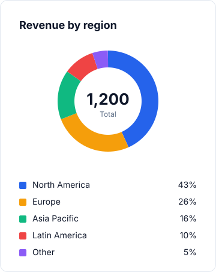

# Task: implement a `DonutChart` card from a mockup

Build a React component that renders the card below. The mockup is one frame of one
dataset, so this document states everything the picture leaves open. Where the mockup
and this text disagree, this text wins.



Mockup dataset: North America 520, Europe 310, Asia Pacific 190, Latin America 120,
Other 60 (total 1,200).

## Scope

Edit only `src/starter/DonutChart.tsx`. It must export a named component `DonutChart`.
Check your work with:

```
IMPL=starter npm run check
```

No chart or SVG libraries. Hand-write the SVG.

## API

```ts
interface DonutDatum {
  label: string // unique within one data array
  value: number // finite, >= 0
}

interface DonutChartProps {
  title: string
  data: DonutDatum[]
}
```

Inputs outside these ranges (duplicate labels, negative, `NaN`, `Infinity`) are not
tested and have no defined behaviour.

## Rendering contract

The checks read geometry from the rendered DOM. They do not read props, state, or any
attribute that states the answer directly (an attribute such as `data-fraction` is not
accepted as evidence). The ring is a set of stroked circles, and each arc's size and
position are derived from the dash attributes.

The chart is one `<svg>` with `viewBox="0 0 200 200"`. Inside it:

- One `<circle>` per drawn segment, with exactly these attributes:

  | Attribute | Value |
  | --- | --- |
  | `data-segment` | the category label |
  | `cx`, `cy` | `100`, `100` |
  | `r` | `70` |
  | `fill` | `none` |
  | `stroke` | the segment colour, from the palette below |
  | `stroke-dasharray` | `<arc> <rest>`: two numbers, `<arc>` being the arc length in user units (`C * fraction`, with `C = 2 * PI * 70`). `<rest>` is not checked |
  | `stroke-dashoffset` | `-<start>`: the negated arc length consumed by earlier segments (`0` for the first) |
  | `transform` | `rotate(-90 100 100)` |

  A circle's dash pattern starts at 3 o'clock and runs clockwise. The `rotate(-90 ...)`
  moves the start to 12 o'clock, so `start` is measured clockwise from 12 o'clock.
  `stroke-width` is not checked.
- Segments are `<circle>` elements. `<path>` arcs are not accepted.
- Extra attributes are allowed and ignored, except that `data-active` is defined below.
- Two `<text>` elements for the centre: `data-testid="centre-value"` (the big number)
  and `data-testid="centre-caption"` (the small line under it).

Outside the `<svg>`, in the card:

- The title as an `<h2>`.
- The legend as a `<ul>` with one `<li data-legend="<label>">` per category, in
  rendered order. Each item's text contains the label and the percentage as an integer
  followed by `%` (for example `43%`). Include zero-value categories.
- Empty state (below): an element with `data-testid="empty-state"`.

### Tolerance

For every segment, `<arc> / C` must be within **0.002** of the expected fraction, and
`<start> / C` within **0.002** of the expected start. That is about 0.7 degrees of arc.
Round attribute values to three decimals or better.

## Behaviour

### Order

Segments and legend items are sorted by `value` descending. Ties are broken by `label`
ascending, compared with `<` on the strings (so `"Zed"` sorts before `"alpha"`). This
order is used for the ring, the legend, and the palette colours. It does not depend on
the order of `data`.

### Start angle and direction

The first segment starts at 12 o'clock. Segments run clockwise and are contiguous with
no gaps. Segment `n` starts where segment `n-1` ended.

### Percentages

The legend percentage is an integer. The integers across all legend items must sum to
exactly 100. Compute them with the largest-remainder method:

1. `exact = value * 100 / total` for every category.
2. Take `floor(exact)` for every category.
3. Give the points still missing from 100, one each, to the categories with the largest
   `exact - floor(exact)`. Ties in the remainder go to the category that comes first in
   the rendered order. Zero-value categories never receive a point.

Examples: three equal values give 34, 33, 33 (the first label alphabetically gets 34).
Eight equal values give 13, 13, 13, 13, 12, 12, 12, 12. Rounding each share on its own
gives 99 and 104 for those two cases, which is wrong.

### Zero-value categories

A category with `value` 0 gets no `<circle>`. It still appears in the legend, with `0%`,
after all non-zero categories (it sorts last by the order rule).

### Empty data

If `data` is empty, or every value is 0, render the title and an element with
`data-testid="empty-state"` containing the text `No data`. Render no segment circles,
no legend items, and no `NaN` anywhere in the text.

### Single non-zero category

One circle whose arc is the full circumference (fraction 1, start 0). The legend shows
`100%`.

### Total and number format

The total is the sum of all values. Numbers (the total and per-category values) are
formatted with `toLocaleString('en-US')`, for example `1,200`.

### Colours

Segment `i` in rendered order (0-based) uses `PALETTE[i % 6]` for its `stroke`, and the
same colour for its legend swatch:

```
#2563eb  #f59e0b  #10b981  #ef4444  #8b5cf6  #64748b
```

## Accessibility

- The `<svg>` has `role="img"` and an accessible name that contains both the title and
  the formatted total, for example `Revenue by region, total 1,200`.
- The title is a heading (`<h2>`).
- Every legend item is keyboard focusable and reachable with Tab in legend order. The
  `<svg>` is not a tab stop.

## Interaction

- Hovering a legend item, or focusing it, makes it active. At most one item is active.
- While an item is active, its segment has `data-active="true"` (other segments do not
  have that value), `centre-value` shows the item's value, and `centre-caption` shows
  its label.
- When no item is active, `centre-value` shows the total and `centre-caption` shows
  `Total`.
- Leaving the item (mouse leaves, or focus moves away) restores the total.
- An active zero-value item has no segment to mark. The centre still shows `0` and the
  item's label.

## Not graded

- Fonts, font sizes, spacing, card size, borders, shadows.
- Exact colours beyond using the palette in the stated order.
- `stroke-width`, `opacity`, or any other visual treatment of the active state beyond
  `data-active` and the centre text.
- Animation and transitions.
- Responsive behaviour, dark mode, text truncation.
- Code style and structure.
